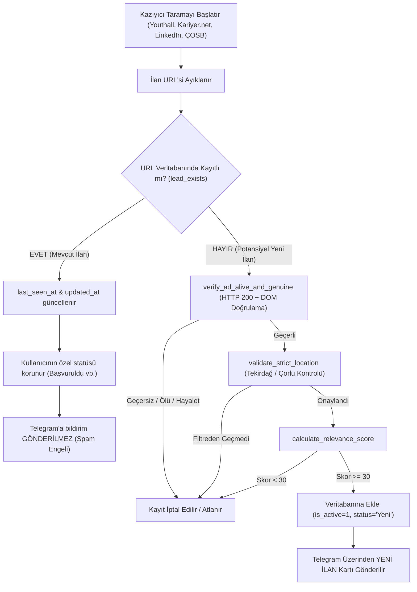

# TNKÜ İME & Staj Telegram Robotu - Mevcut Mimari ve Konfigürasyon Özeti

> **Belge Amacı:** Projenin mevcut dosya yapısını, taranan tüm veri kaynaklarını, filtreleme algoritmalarını, skorlama matrisini, önbellek ve veritabanı çalışma prensiplerini eksiksiz ve koda dokunmadan belgelemektir.

---

## 1. Proje Dosya Ağacı ve Kullanılan Kütüphaneler

### 1.1. Proje Dosya Ağacı
```text
ime_staj_bot/
│
├── .env                               # Gizli ortam değişkenleri (Bot Token, Chat ID, Port vb.)
├── .env.example                       # Örnek çevre değişkenleri şablonu
├── .gitignore                         # Git sürüm kontrolü dışlama listesi
│
├── bot_listener.py                    # Telegram Long-Polling dinleyicisi, buton menüsü, canlı doğrulama motoru & Render HTTP healthcheck
├── config.py                          # Sistem konfigürasyonu, katı lokasyon beyaz listesi, negatif filtreler, skorlama katsayıları
├── database.py                        # SQLite veritabanı katmanı, CRUD, Upsert/Append mantığı, filtreleme ve metrik sorguları
├── main.py                            # Konsol ve sunucu (CLI / Server mode) orkestratörü
├── notifier.py                        # Telegram Bot bildirim formatlayıcısı ve mesaj iletim modülü
│
├── scrapers/                          # Veri Kazıma ve API Entegrasyon Modülleri
│   ├── __init__.py                    # Modül tanımlayıcısı
│   ├── youthall.py                    # Youthall Staj & Genç Yetenek İlanları Kazıyıcı
│   ├── job_portals.py                 # Kariyer.net ve LinkedIn Guest API entegrasyonu
│   ├── active_jobs.py                 # ÇOSB Resmi Kariyer Portalı, DuckDuckGo & Playwright tarayıcısı
│   └── osb_directory.py               # Trakya OSB kurumsal üretim tesisleri statik rehberi
│
├── ime_leads.db                       # SQLite veritabanı dosyası (leads ve bot_meta tabloları)
│
├── requirements.txt                   # Python bağımlılık listesi
├── Dockerfile                         # Konteyner imaj tanımlayıcısı (Python 3.12-slim)
├── docker-compose.yml                 # Yerel konteyner orkestrasyonu
├── Procfile                           # Render.com / Cloud PaaS süreç başlatıcı (web: python main.py --server)
├── systemd/
│   └── ime_bot.service                # Linux sunucular için systemd servis yapılandırması
│
├── bot_baslat.bat                     # Windows hızlı başlatma betiği
├── run.bat / run.ps1                  # Windows CMD / PowerShell çalıştırma betikleri
└── tnku_bot_startup.vbs               # Arka planda sessiz çalıştırma Windows VBS betiği
```

### 1.2. Kullanılan Kütüphaneler ve Bağımlılıklar

#### `requirements.txt` İçeriği:
```text
requests>=2.31.0
beautifulsoup4>=4.12.0
python-dotenv>=1.0.0
schedule>=1.2.0
lxml>=5.0.0
playwright>=1.40.0
```

#### Modüllere Göre Kütüphane Dağılımı ve Görevleri:
| Kütüphane / Modül | Kullanım Yeri | Görevi / Amacı |
| :--- | :--- | :--- |
| `requests` | Tüm scrapers, `bot_listener.py`, `notifier.py` | Web sayfalarının indirilmesi, Telegram Bot API istekleri ve ölü link HEAD/GET kontrolleri. |
| `beautifulsoup4` (bs4) | Tüm scrapers | HTML ağacından başlık, şirket, lokasyon ve etiketlerin DOM seçicileriyle ayıklanması. |
| `sqlite3` (Dahili) | `database.py` | Yerel veritabanı işlemleri, indeksleme, upsert ve analitik filtrelemeler. |
| `concurrent.futures` | `bot_listener.py` | İlan linklerinin paralel (8 worker) olarak 404/redirect kontrolünden geçirilmesi. |
| `http.server` (Dahili) | `bot_listener.py` | Render.com web servisinin uyumasını engellemek için arka planda açılan HTTP Health-Check sunucusu. |
| `threading` (Dahili) | `bot_listener.py` | Telegram dinleyicisi, periyodik tarayıcı ve HTTP sunucusunun aynı süreçte eşzamanlı çalışması. |
| `python-dotenv` | `config.py` | `.env` dosyasındaki token ve ortam değişkenlerinin yüklenmesi. |
| `urllib.parse` (Dahili) | `scrapers/*`, `bot_listener.py` | URL kodlama/çözme, domain ve yönlendirme kontrolü. |
| `re` (Dahili) | `config.py`, `bot_listener.py` | Katı beyaz liste eşleme, spam filtreleme ve kelime kökü analizi. |
| `playwright` (Opsiyonel) | `scrapers/active_jobs.py` | Dinamik JS render gerektiren sayfalar için headless tarayıcı motoru. |

---

## 2. Taranan Tüm URL'lerin, RSS/API Kaynaklarının ve Arama Sorgularının Tam Listesi

Sistemde harici RSS kaynağı bulunmamakta olup, doğrudan HTML scraping ve açık JSON/Guest API'ler kullanılmaktadır.

### 2.1. Youthall (`scrapers/youthall.py`)
Youthall üzerinde kampüse yakın ilanları çekmek için hedeflenen URL listesi:
1. `https://www.youthall.com/tr/is-ilanlari/tekirdag/`
2. `https://www.youthall.com/tr/is-ilanlari/tekirdag/?order=1` *(Yeniden eskiye sıralı)*
3. `https://www.youthall.com/tr/is-ilanlari/tekirdag/stajyer/` *(Stajyer filtresi)*
4. `https://www.youthall.com/tr/is-ilanlari/?query=%C3%A7orlu` *(Çorlu sorgusu)*
5. `https://www.youthall.com/tr/is-ilanlari/?query=%C3%A7erkezk%C3%B6y` *(Çerkezköy sorgusu)*
6. `https://www.youthall.com/tr/is-ilanlari/?query=ergene` *(Ergene sorgusu)*

- **Kart DOM Seçicisi:** `div.jobs`
- **Resmi Lokasyon Etiketi:** `div.jobs-tag` içerisindeki `<i class="fas fa-map-marker-alt">` elementi.
- **Detay Sayfası Doğrulama:** `h1` (Tam başlık), `div.c-job_info_company` (Resmi şirket adı).

---

### 2.2. Kariyer.net (`scrapers/job_portals.py`)
Kariyer.net üzerinde 3 farklı şehir/ilçe slug'ı ile 9 farklı arama terimi kombine edilir (Toplam 27 arama isteği):

- **Temel URL Deseni:**
  `https://www.kariyer.net/is-ilanlari/{location_slug}?kw={encoded_kw}`

- **Taranan Şehir Slug'ları (`city_slugs`):**
  - `tekirdag`
  - `tekirdag-corlu`
  - `tekirdag-cerkezkoy`

- **Aranan Pozisyon Anahtar Kelimeleri (`queries`):**
  1. `stajyer`
  2. `staj`
  3. `aday mühendis`
  4. `uzun dönem`
  5. `İME`
  6. `işletmede mesleki eğitim`
  7. `elektrik stajyer`
  8. `otomasyon stajyer`
  9. `elektrik bakım`

- **DOM Seçicileri:**
  - İlan Linkleri: `a[href*="/is-ilani/"]`
  - Detay Sayfası Lokasyon: `.company-location, [data-test*='location']`
  - Liste Kartı Lokasyon Yedek Etiketi: `.location, [data-test*='card-location']`
  - İlan Başlığı: `h1, [data-test*='job-title']`
  - Şirket Adı: `.company-name, [data-test*='company-name']`

---

### 2.3. LinkedIn Guest API (`scrapers/job_portals.py`)
LinkedIn'in herkese açık seeMoreJobPostings arama servisi üzerinden çekilir:

- **API URL Deseni:**
  `https://www.linkedin.com/jobs-guest/jobs/api/seeMoreJobPostings/search?keywords={keywords}&location={location}&start=0`

- **Sorgu Çiftleri (`queries`):**
  1. Anahtar Kelime: `stajyer` | Lokasyon: `Tekirdağ`
  2. Anahtar Kelime: `intern` | Lokasyon: `Tekirdağ`
  3. Anahtar Kelime: `uzun dönem stajyer` | Lokasyon: `Çorlu`
  4. Anahtar Kelime: `aday mühendis` | Lokasyon: `Çerkezköy`

- **DOM Seçicileri:**
  - Kartlar: `li, div.base-card`
  - Başlık: `h3, .base-search-card__title`
  - Şirket: `h4, .base-search-card__subtitle`
  - Lokasyon Etiketi: `.job-search-card__location`
  - İlan URL: `a.base-card__full-link, a[href*='linkedin.com/jobs']`

---

### 2.4. ÇOSB Özel İstihdam Portalı (`scrapers/active_jobs.py`)
Çerkezköy Organize Sanayi Bölge Müdürlüğü'nün resmi istihdam portalı:

- **Ana Sayfa:** `https://kariyer.cosb.org.tr`
- **İlan Detay Deseni:** `https://kariyer.cosb.org.tr/Baglan/Ilan?_IlaNo={İlanNo}`
- **DOM Seçicisi:** `a[href*="/Baglan/Ilan?_IlaNo="]` ve detay sayfasındaki `* Açıklama` bloğu.

---

### 2.5. DuckDuckGo & Playwright Canlı Arama Motoru (`scrapers/active_jobs.py`)
Arama motorları üzerinden staj sorguları (Yalnızca ek kaynak olarak):
- **DuckDuckGo HTML Arama URL:** `https://html.duckduckgo.com/html/?q={encoded_query}`
- **Kombinasyon Terimleri:**
  `["staj", "stajyer", "İME", "elektrik"]` × `["Çorlu", "Çerkezköy", "Tekirdağ", "Ergene"]`

---

## 3. Şehir, Tarih, Anahtar Kelime ve Filtreleme Kuralları (Birebir Kod Verisi)

Sistem şu anda **harici bir LLM API'sine (OpenAI/Gemini vb.) bağlı olmayıp**, 0 maliyet, sıfır gecikme ve %100 deterministik çalışacak şekilde **Python tabanlı Katı Kural & Heuristic Skorlama Motoru** ile filtreleme yapmaktadır.

### 3.1. Hedef Şehir ve Katı Lokasyon Beyaz Listesi (`config.py`)
Bir ilanın geçerli sayılabilmesi için sitenin belirlediği ana lokasyon etiketinde aşağıdaki terimlerden en az biri **kesinlikle** geçmelidir:

```python
STRICT_LOCATIONS_WHITELIST = [
    "tekirdağ", "tekirdag",
    "çorlu", "corlu",
    "çerkezköy", "cerkezkoy",
    "ergene",
    "kapaklı", "kapakli",
    "süleymanpaşa", "suleymanpasa",
    "marmaraereğlisi", "marmaraereglisi",
    "muratlı", "muratli",
    "velimeşe", "velimese",
    "hayrabolu",
    "saray",
    "şarköy", "sarkoy",
]
```

---

### 3.2. Kara Listeler ve Alakasız Şehirler

#### 1. Çoklu Şehir / Türkiye Geneli Kara Listesi (`MULTI_CITY_BLACKLIST`):
```python
MULTI_CITY_BLACKLIST = [
    "türkiye geneli", "turkiye geneli",
    "tüm şehirler", "tum sehirler",
    "tüm iller", "tum iller",
    "81 il", "tum turkiye", "tüm türkiye",
    "tümü", "tumu",
    "il daha",
]
```

#### 2. Bölgesel Alakasız Dağıtım Şirketleri (`WRONG_REGIONAL_FIRMS`):
```python
WRONG_REGIONAL_FIRMS = [
    "yedaş", "yedas", "yeşilırmak", "yesilirmak",  # Karadeniz
    "toroslar",                                    # Güney / Adana
    "ayedaş", "ayedas", "bedaş", "bedas",
    "başkent edaş", "baskent edas", "başkent elektrik", "baskent elektrik",
    "gdz", "gediz", "aydem", "adm elektrik",
    "dicle edaş", "dicle edas", "dicle elektrik",
    "çoruh edaş", "coruh edas", "çoruh elektrik", "coruh elektrik",
    "aras edaş", "aras edas", "aras elektrik",
    "fırat edaş", "firat edas", "fırat elektrik", "firat elektrik",
    "osmangazi edaş", "oedaş", "oedas",
    "uludağ edaş", "uedaş", "uedas",
    "çamlıbel edaş", "cedaş", "cedas",
    "akdeniz edaş", "akdeniz elektrik",
    "meram edaş", "meram edas", "meram elektrik",
    "dh teknik", "şara enerji", "sara enerji", "akbaş enerji", "green diamond", "remax"
]
```

#### 3. Tekirdağ Dışındaki 80 İl Kara Listesi (`WRONG_CITIES`):
```python
WRONG_CITIES = [
    "adana", "adıyaman", "afyon", "afyonkarahisar", "ağrı", "aksaray", "amasya",
    "ankara", "antalya", "ardahan", "artvin", "aydın", "balıkesir", "bartın",
    "batman", "bayburt", "bilecik", "bingöl", "bitlis", "bolu", "burdur",
    "bursa", "çanakkale", "çankırı", "çorum", "denizli", "diyarbakır", "düzce",
    "elazığ", "erzincan", "erzurum", "eskişehir", "gaziantep", "giresun",
    "gümüşhane", "hakkari", "hatay", "iğdır", "isparta", "izmir",
    "kahramanmaraş", "karabük", "karaman", "kars", "kastamonu", "kayseri",
    "kırıkkale", "kırklareli", "kırşehir", "kilis", "kocaeli", "konya",
    "kütahya", "malatya", "manisa", "mardin", "mersin", "muğla", "muş",
    "nevşehir", "niğde", "ordu", "osmaniye", "rize", "sakarya", "samsun",
    "siirt", "sinop", "sivas", "şanlıurfa", "şırnak", "tokat", "trabzon",
    "tunceli", "uşak", "van", "yalova", "yozgat", "zonguldak"
]
```

---

### 3.3. Negatif Anahtar Kelimeler (Öğrenciye Uygun Olmayan / Kesin Eleme)
```python
NEGATIVE_KEYWORDS = [
    # Kıdemli / Yönetici / Şantiye (Öğrenci İME yapamaz!)
    "şantiye şefi", "şantiye", "müdür", "yönetici", "kıdemli", "senior",
    "direktör", "şef", "başmühendis", "bölge müdürü", "proje müdürü",

    # Mühendislik Dışı Sektörler
    "insan kaynakları", "human resources", "ik staj", "ik uzman", "insan ve kültür",
    "finans", "muhasebe", "accounting", "finance", "mali işler", "ön muhasebe",
    "lojistik", "logistics", "depo", "sevkiyat", "ithalat", "ihracat", "dış ticaret",
    "hukuk", "avukat", "legal",
    "pazarlama", "marketing", "sosyal medya", "grafik", "tasarımcı", "reklam",
    "kurumsal iletişim", "halkla ilişkiler",
    "satış temsilcisi", "satış danışmanı", "satış elemanı", "kasiyer", "mağaza",
    "çağrı merkezi", "call center", "müşteri temsilcisi", "satış",
    "gayrimenkul", "emlak", "garson", "şoför", "aşçı", "mutfak",
    "güvenlik", "temizlik", "kurye", "vale",
    "diş hekimi", "dental", "veteriner", "eczacı", "eczane", "hemşire", "hasta kabul",
    "doktor", "sağlık personeli", "çocuk gelişim", "öğretmen", "parfüm", "gıda stajyeri"
]
```

---

### 3.4. E-E Mühendisliği Skorlama Matrisi (`EE_KEYWORD_WEIGHTS`)
Başlık veya açıklamada geçen terimlere göre ilana eklenen puanlar:
```python
EE_KEYWORD_WEIGHTS = {
    "elektrik-elektronik": 35,
    "elektrik elektronik": 35,
    "elektrik mühendisi": 25,
    "elektronik mühendisi": 25,
    "otomasyon": 30,
    "plc": 30,
    "scada": 25,
    "mekatronik": 25,
    "elektrik bakım": 25,
    "bakım onarım": 20,
    "pano": 20,
    "eplan": 20,
    "autocad": 10,
    "gömülü": 25,
    "embedded": 25,
    "donanım": 20,
    "hardware": 20,
    "yüksek gerilim": 20,
    "trafo": 18,
    "enerji": 15,
    "sürücü": 15,
    "inverter": 15,
    "ar-ge": 15,
    "test": 12,
    "üretim": 10,
    "elektrik": 15,
    "elektronik": 15,
}
```

---

### 3.5. Puan Hesaplama Algoritması (`calculate_relevance_score`)
1. **Lokasyon Doğrulaması:** `validate_strict_location(location, title, company)` çalıştırılır. Başarısızsa `Puan = 0`.
2. **Kıdem Kontrolü:** Başlık veya metinde `NEGATIVE_KEYWORDS` varsa `Puan = 0`.
3. **Stajyer/Öğrenci Formatı:** Başlıkta `ime`, `işletmede mesleki eğitim`, `staj`, `intern`, `aday mühendis`, `öğrenci`, `genç yetenek`, `uzun dönem` geçmek zorundadır. Aksi takdirde `Puan = 0`.
4. **Staj Türü Taban Puanları:**
   - İME / İşletmede Mesleki Eğitim: **+45 Puan**
   - Aday Mühendis: **+40 Puan**
   - Uzun Dönem: **+35 Puan**
   - Stajyer / Staj: **+30 Puan**
5. **Teknik Uygunluk:** `EE_KEYWORD_WEIGHTS` tablosundaki ağırlıklar eklenir.
6. **Bölge Bonusu:** Lokasyon resmi olarak Tekirdağ/Çorlu/Çerkezköy havzasında ise **+15 Puan**.
7. **Tarih / Tazelik Bonusu:** İlan son 3 gün içinde yayınlanmışsa **+10 Puan**.
8. **Sınır:** Puan minimum 0, maksimum 100 olarak sınırlandırılır.

---

### 3.6. Ölü Link ve DOM Geçerlilik Doğrulama Kuralları (`verify_ad_alive_and_genuine`)
İlan listelenmeden veya kaydedilmeden hemen önce doğrulanır:
- HTTP Durum Kodu `>= 400` ise red.
- Nihai URL kök/ana sayfaya (`/`, `/tr`, `/en`, `/index.html`, `/login` vb.) yönleniyorsa red.
- Sayfa HTML'inde şu ifadeler geçiyorsa red:
  - `"ilan yayından kaldırılmıştır"`, `"ilan yayından kalkmıştır"`, `"bu sayfa bulunamadı"`, `"no longer available"`, `"job is closed"`, `"job has expired"`, `"bu ilanın yayın süresi dolmuştur"`, `"arama kriterlerinize uygun ilan bulunamadı"`, `"404 not found"`.
- **DOM İsim & Başlık Doğrulaması:** Sayfa HTML metninde, ilanın **Şirket Adı** ve **İlan Başlığı** anahtar kelimeleri bulunamazsa ("Hayalet İlan") red.

---

## 4. Önbellek (Cache) ve Veritabanı Kayıt Mantığı

### 4.1. Veritabanı Mimarisi (SQLite - `ime_leads.db`)

#### `leads` Tablosu Şeması:
| Sütun | Veri Tipi | Kısıt / Varsayılan | Açıklama |
| :--- | :--- | :--- | :--- |
| `id` | `INTEGER` | `PRIMARY KEY AUTOINCREMENT` | Benzersiz kayıt ID |
| `company` | `TEXT` | `NOT NULL` | Şirket / Kurum Adı |
| `title` | `TEXT` | `NOT NULL` | Pozisyon Başlığı |
| `location` | `TEXT` | - | Doğrulanmış Lokasyon |
| `url` | `TEXT` | `UNIQUE NOT NULL` | İlan başvuru bağlantısı (Mükerrerlik engeli) |
| `source` | `TEXT` | `NOT NULL` | Kaynak (`Youthall`, `Kariyer.net`, `LinkedIn`, `ÇOSB`) |
| `relevance_score` | `INTEGER` | `DEFAULT 0` | 0-100 arası E-E uygunluk puanı |
| `status` | `TEXT` | `DEFAULT 'Yeni'` | Başvuru durumu (`Yeni`, `İncelendi`, `Başvuruldu` vb.) |
| `notes` | `TEXT` | - | İlan özeti veya başvuru notları |
| `created_at` | `TIMESTAMP` | `CURRENT_TIMESTAMP` | Sisteme ilk kayıt tarihi |
| `updated_at` | `TIMESTAMP` | `CURRENT_TIMESTAMP` | Son güncelleme tarihi |
| `last_seen_at` | `TIMESTAMP` | `CURRENT_TIMESTAMP` | Taramada ilanın en son görüldüğü zaman |
| `is_active` | `INTEGER` | `DEFAULT 1` | 1: Aktif, 0: Yayından kalkmış / Ölü link |

#### `bot_meta` Tablosu Şeması:
| Sütun | Veri Tipi | Kısıt | Açıklama |
| :--- | :--- | :--- | :--- |
| `key` | `TEXT` | `PRIMARY KEY` | Ayar / Sayaç anahtarı (`last_scan_time`) |
| `val` | `TEXT` | - | Değer (Örn: `18.11.2026 00:13`) |

#### İndeksler (Sorgu Hızlandırma & Mükerrer Kayıt Engeli):
- `idx_leads_url` (`leads(url)`) -> Hızlı varlık/önbellek kontrolü
- `idx_leads_status` (`leads(status)`)
- `idx_leads_score` (`leads(relevance_score)`)
- `idx_leads_created` (`leads(created_at)`)
- `idx_leads_source` (`leads(source)`)
- `idx_leads_active` (`leads(is_active)`)

---

### 4.2. Önbellek, Upsert (Append/Update) ve Bildirim Yaşam Döngüsü



### 4.3. Veritabanı Temizlik ve Önbellek Düşürme (Cache Eviction) Yöntemleri
1. **Dinamik Ölü Link Temizliği (`filter_alive_leads`):** Kullanıcı `/ilk20` veya `/tum_ilanlar` istediğinde, listedeki tüm linkler paralel olarak taranır. 404/kapanmış ilan tespit edilirse veritabanında `is_active = 0` yapılarak listeden düşürülür.
2. **Periyodik Otomatik Temizlik (`purge_invalid_leads`):** Sistem her açılışında ve `/temizle` komutu verildiğinde; kara listedeki şehirleri, şirketleri, kıdemli pozisyonları ve `is_active = 0` olan kayıtları veritabanından kalıcı olarak siler (`DELETE FROM leads`).
3. **Tam Sıfırlama (`flush_all_leads`):** `/flush` komutu ile tüm kayıtlar sıfırlanıp taze canlı tarama ile yeniden doldurulabilir.
